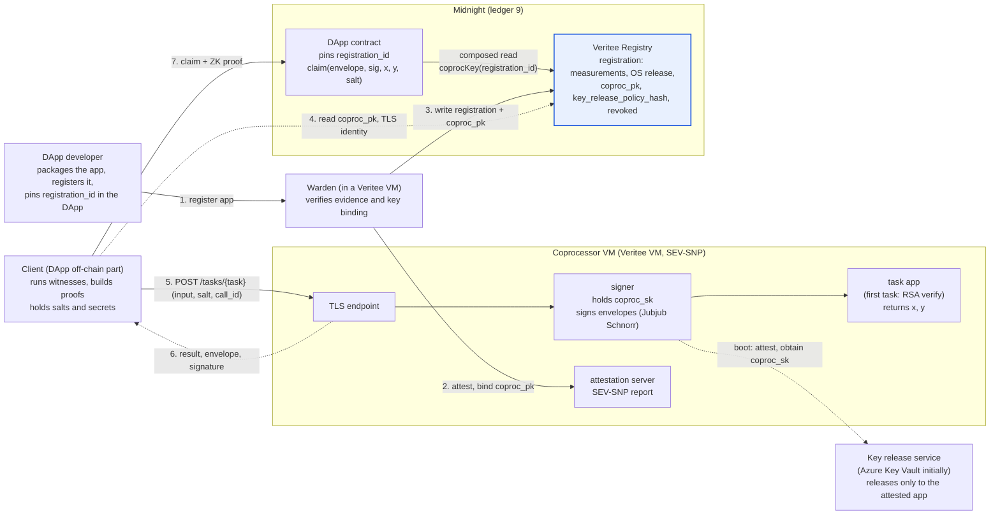

# Veritee TEE Coprocessor for Compact

Status: proposal for review, 2026-11-18. Targets Midnight ledger 9.

## 1. Motivation

A Compact contract can only use what its circuit can prove. Many useful computations
are too heavy to prove in zero knowledge, or cannot be expressed in a circuit at all.

The TEE coprocessor is a generic pattern for those computations: **a Compact contract
hands a computation to an attested TEE and gets back a result it can check inside its
own circuit.** The TEE does the work; the circuit only verifies who did it.

| Family | Examples |
|---|---|
| Standard cryptography | RSA, X.509 chains, TLS transcripts |
| FHE | computing on encrypted data |
| Rollups | validium, attested rollup client |
| AI / ML | model inference with signed outputs |

The pattern keeps Midnight's privacy model. Inputs travel to the TEE over an attested
TLS channel, the chain sees only a commitment to inputs and result, and the DApp
discloses what it chooses. The VM operator learns nothing.

This document specifies the pattern for any task. RSA PKCS#1 v1.5 signature
verification is the first task and is used as the running example.

## 2. Overview

- A DApp developer packages a **coprocessor app**: a signer plus one or more task
  apps, running in a Veritee confidential VM.
- The app owns a long-lived signing key, the **coprocessor key**, which exists only
  inside attested VMs of that app.
- The developer registers the app with the Veritee **Warden**. The Warden verifies the
  VM's attestation and records the app's measurements and its coprocessor public key
  in the **Veritee Registry**, a contract on Midnight.
- The **client** is the DApp's off-chain part: the code on the user's side that holds
  the private state, runs the contract's witnesses and builds its proofs. It calls the
  coprocessor over TLS and receives a result with a signed **envelope**: a commitment
  to the inputs and the result, signed by the coprocessor key.
- The client then proves a `claim` on the DApp contract, supplying the result and the
  envelope's opening as witnesses. The contract reads the coprocessor
  public key from the Veritee Registry by contract composition, verifies the signature
  inside its circuit, and opens the commitment against private witnesses.

The coprocessor is opt-in: Veritee apps that do not use it are unaffected (§4.8).

Calls are off-chain. The coprocessor VM never submits a transaction; only the client's
`claim` touches the ledger. Registration happens once per app, with no step per VM
boot or per replica.

## 3. Background

### 3.1 Veritee

| Component | Role |
|---|---|
| Veritee VM | A confidential VM (AMD SEV-SNP) built from a reproducible base OS image. The application lives on a dm-verity application disk whose root hash is measured at boot. |
| Warden | The attestation verifier. It runs in a Veritee VM itself. It verifies SEV-SNP evidence against expected measurements and approved OS releases. |
| Veritee Registry | The Warden's contract on Midnight. It holds one **registration** per admitted app image (measurements, application disk root hash, OS release) and supports revocation. |

A DApp developer already registers a TEE app with the Warden to make its attestation
publicly checkable. The coprocessor builds on that registration.

### 3.2 What the design uses from ledger 9

Checked against the ledger 9.1 sources and the Compact 0.34 and 0.35 release notes.
Nothing here has been compiled or measured yet; that is phase 0 (§7).

| Capability | Status |
|---|---|
| `jubjubSchnorrVerify` in the Compact standard library | Present. Schnorr over the embedded Jubjub curve with a Poseidon challenge over a list of Fields. |
| Matching Rust signer | Present in `midnight-transient-crypto` (`schnorr::sign`, `verify`). |
| Cross-contract calls | Present since Compact 0.33; `kernel.caller()` since 0.35. |
| Other in-circuit verifiers | `secp256k1EcdsaVerify`, `secp256r1EcdsaVerify`, `ed25519Verify`. The last two need `--feature-zkir-v3`; mainnet availability of that flag is unconfirmed. |
| In-circuit hashes | Poseidon (`transientHash`), SHA-256 (`persistentHash`), `keccak256`, `sha512`. |

Ledger 9 contracts are compiled with Compact 0.36.

## 4. Design



Steps 1 to 3 run once per app image. Steps 4 to 7 run per call.

### 4.1 Actors

| Actor | Role |
|---|---|
| DApp developer | Packages the coprocessor app disk, registers it with the Warden, deploys VMs, pins the `veritee_registration_id` in the DApp contract. |
| Warden | Verifies attestation evidence, binds the coprocessor key to the registration, writes the Veritee Registry. |
| Veritee Registry | Holds registrations and revocations, including the coprocessor key. Exposes a read circuit for composition. |
| Coprocessor VM | Runs the TLS endpoint, the signer and one or more task apps. Holds `coproc_sk`. Never talks to the chain. |
| Key release service | Makes `coproc_sk` available to a VM only after attestation of that app (§4.2). |
| Client | The DApp's off-chain part, on the user's side: holds private state, runs witnesses, builds proofs. Calls the VM over TLS, then proves `claim` on the DApp. |

### 4.2 The coprocessor key

One key pair per app registration: `coproc_sk`, `coproc_pk`. The scheme is **Jubjub
Schnorr**, verified with the standard library's `jubjubSchnorrVerify` and signed with
the matching `midnight-transient-crypto` implementation. The key is long-lived: it
survives reboots and redeploys and is shared by all replicas of the app. It signs
result envelopes and nothing else. The TLS key is separate; it only protects the
client channel.

Lifecycle:

1. **Creation.** The first attested VM of the app generates `coproc_sk` inside the TEE.
   It wraps it with a key that the key release service gives only to VMs attesting as
   this app, and stores the wrapped blob.
2. **Binding.** During registration the Warden requests attestation evidence whose
   report data binds a fresh nonce and `coproc_pk`. It verifies the evidence, verifies
   the key release policy, and writes `coproc_pk` and `key_release_policy_hash` into
   the registration. The key field is set once.
3. **Use.** Every later boot and every replica attests, obtains the wrapping key,
   unwraps `coproc_sk`, and serves. No transaction is involved.
4. **Rotation and compromise.** A new key means a new registration. A leaked key is
   handled by revoking the registration.

**Why Jubjub Schnorr.** It is the audited standard-library verifier on ledger 9 and the
cheapest signature to check in a circuit, because Jubjub is the embedded curve. A Rust
signer already exists. ECDSA over secp256k1 or P-256 would only add value if the key
never left its custody system; with the initial key release mechanism the key material
ends up inside the attested VM either way, so the curve does not change custody. The
registration records `coproc_key_scheme`, so a later registration can use another
scheme, most likely secp256k1 ECDSA, once a key mechanism exists that signs without
releasing the key. DApps are unaffected, because the shared Compact module (§4.5)
dispatches on the scheme.

**Key release initially: Azure Key Vault.** Secure key release under an attestation
policy, the mechanism Veritee already uses for TLS keys. Key Vault holds the wrapping
key, not the Jubjub key. This puts Key Vault policy administrators and the cloud
provider in the trust base, and it is Azure-only.

**Key release in the future: a common Veritee mechanism.** Veritee needs one key
survival and release service shared by every Veritee system (coprocessor keys, TLS
keys, the Warden's own keys), considerably more hardened than Key Vault, releasing
strictly per app attestation. Candidates to evaluate: a dedicated HSM with
attestation-gated release, an SGX-based key service, or a threshold key network in the
style of NEAR's MPC, where no single party ever holds the key. The coprocessor depends
only on the interface, "make this app's key usable by a VM that attests as this app",
so the mechanism can be replaced without touching the protocol, the contracts or the
DApps. Only `key_release_policy_hash` changes meaning.

### 4.3 Veritee Registry additions

- The registration record gains `coproc_pk: JubjubPoint` (optional, set once),
  `coproc_key_scheme` (one value initially: Jubjub Schnorr) and
  `key_release_policy_hash`.
- A read circuit `coprocKey(registration_id) -> JubjubPoint`. It fails if the
  registration is unknown, revoked, or has no coprocessor key.

The coprocessor needs no contract of its own. All three fields are absent for apps
that are not coprocessors (§4.8).

### 4.4 Envelope

The signer signs a list of Fields:

```
[ label("veritee-env-v1"), scope, task_id, call_id, commitment ]
```

- `label`: a domain separator, the UTF-8 label as a Field.
- `scope`: the DApp's contract address. Prevents replay across DApps.
- `task_id`: `transientHash([label(task name)])`. Names the task and its version.
- `call_id`: a fresh value chosen by the client. Prevents replay within a DApp.
- `commitment = transientCommit(x || y, salt)`: commits to the task's input encoding
  `x` and result encoding `y` (§4.6) under a salt chosen by the client.

The envelope is public. The inputs, the result and the salt stay private witnesses of
the client.

### 4.5 DApp `claim`

```compact
circuit claim(env: Envelope, sig: Signature, x: Vector<N, Field>, y: Vector<M, Field>, salt: Field) {
  const pk = VeriteeRegistry.coprocKey(VERITEE_REGISTRATION_ID);   // composed read
  assert(jubjubSchnorrVerify(pk, envelopeFields(env), sig), "bad signature");
  assert(env.scope == ownAddress(), "wrong scope");
  assert(env.task_id == TASK_ID, "wrong task");
  assert(!seen.member(env.call_id), "replay");
  seen.insert(env.call_id);
  assert(env.commitment == transientCommit(x ++ y, salt), "commitment mismatch");
  // task-specific checks on x and y (§4.6)
}
```

The DApp holds one pin, `VERITEE_REGISTRATION_ID`, and its own replay set. The
signature, scope, task and replay checks ship as a shared Compact module so DApps do
not re-implement them. The composed call is read-only. A revocation in the Veritee
Registry takes effect on the next `claim` with no action from the DApp.

### 4.6 Tasks

The protocol is generic over the computation. A task is defined by four things:

| Element | Definition |
|---|---|
| `task_id` | `transientHash([label(name)])`, a Field naming the task and its version. |
| `x: Vector<N, Field>` | Fixed-size encoding of what the result is about: typically hashes or commitments of the inputs, plus a client binding. |
| `y: Vector<M, Field>` | Fixed-size encoding of the result. |
| Task app | A loopback HTTP service behind the signer: `POST /tasks/{task}` takes the task's JSON input and returns `x`, `y` and a client-facing result. |

Rules that hold for every task:

- The task app never sees keys and never signs. The signer commits to `x || y` and
  signs the envelope. A task app cannot forge an envelope for another task, because
  the signer sets `task_id` from its own configuration.
- Large or private inputs stay off-chain. `x` carries only what the circuit needs to
  tie the result to the DApp's own state, usually hashes.
- `x` should include a client binding, `transientHash([client_secret])`, when the
  result must be claimable only by the caller.
- The DApp's circuit decides what `y` means. The coprocessor attests that the task app
  in the pinned image produced `y` for `x`, nothing more.
- Adding or changing a task changes the app disk, so it is a new registration.

**Example: `rsa-pkcs1v15-sha256`.** Input: modulus, exponent, message, signature.
`x = [pk_hash, msg_hash, client_binding]`, where `pk_hash` is a Poseidon hash of the
packed modulus and exponent. `y = [valid]`. The DApp checks that `pk_hash` is the
authority it trusts, that `msg_hash` matches the document it holds as a witness, and
that `valid == 1`. Verifying RSA-2048 directly in a circuit would cost far more than
one Jubjub signature check.

The same shape covers the other families in §1: an X.509 task returns the subject key
hash and validity window, an inference task returns a commitment to the model, the
input and the output, a rollup task returns the new state root for a batch commitment.

### 4.7 Protocol actions

Once per app image:

1. The developer builds the app disk and computes its dm-verity root hash.
2. The developer deploys a VM and registers the app with the Warden.
3. The first VM generates `coproc_sk`, wraps it through the key release service, stores the blob.
4. The Warden pulls evidence binding a fresh nonce and `coproc_pk` in the report data.
5. The Warden verifies the evidence, the measurements and the key release policy.
6. The Warden writes the registration with `coproc_pk` and `key_release_policy_hash`.
7. The developer deploys the DApp pinning the `veritee_registration_id`.

Per VM boot:

8. The VM attests to the key release service and unwraps `coproc_sk`.

Per call:

9. The client reads the registration: `coproc_pk` and the TLS identity of the app.
10. The client connects to the VM over TLS pinned to that identity.
11. The client sends the task input, a fresh `call_id` and a salt.
12. The task app computes `x` and `y`; the signer computes the commitment.
13. The signer signs the envelope with `coproc_sk`.
14. The client receives the result, the envelope and the signature, and checks the signature against `coproc_pk`.

Per claim:

15. The client proves `claim(envelope, sig, x, y, salt)` and submits it.
16. The DApp reads `coproc_pk` from the Veritee Registry by composition.
17. The DApp verifies the signature, then checks scope, task and replay.
18. The DApp opens the commitment against the private witnesses and runs its logic.

Lifecycle:

19. The Warden revokes a registration; every DApp pinning it rejects further claims.
20. A new app version or key is a new registration; the DApp re-pins.

### 4.8 Compatibility with regular Veritee apps

The coprocessor is an opt-in addition. Veritee apps that are not coprocessors keep
working exactly as they do now.

- **Registration.** `coproc_pk`, `coproc_key_scheme` and `key_release_policy_hash` are
  optional fields. A registration without them is valid and unchanged in meaning. The
  Warden performs the key binding step only when the app declares a coprocessor key.
- **Attestation and verification.** The Warden's evidence checks, the measurements it
  records, runtime verifications and revocation are the same for every app. Nothing in
  the base OS image or the attestation server changes.
- **Registry readers.** Existing readers of the Veritee Registry are unaffected.
  `coprocKey` is a new circuit and fails for a registration that has no coprocessor
  key, so a DApp cannot mistake a regular app for a coprocessor.
- **Traffic.** Only envelopes returned by `/tasks/{task}` are signed with the
  coprocessor key. Every other endpoint of an app is served as before, protected by
  the attested TLS channel alone. One app can offer both.
- **Key release.** A regular app needs no coprocessor key and no access to the key
  release service for one.

## 5. Trust and security properties

| Property | Rests on |
|---|---|
| A claimed result was produced by the registered app | The Warden's attestation check at registration, the key binding in the SEV-SNP report data, and the Schnorr signature verified in-circuit. |
| Only attested VMs of the app hold `coproc_sk` | The key release mechanism and its policy, whose hash is recorded in the registration (§4.2). |
| The client's inputs reach only the attested app | TLS pinned to the identity in the registration. |
| The chain learns nothing beyond what the DApp discloses | The envelope carries only a salted commitment; `x`, `y` and the salt are private witnesses. |
| A result cannot be claimed twice or in another DApp | `call_id` in the DApp's replay set and `scope` in the envelope. |
| A compromised app or key can be shut off | Revocation in the Veritee Registry, read on every `claim`. |

Trusted parties: the TEE hardware vendor, the Warden, and the key release mechanism.
The DApp developer chooses which registration to pin and is not trusted by the
protocol beyond that.

## 6. Design decisions

| Decision | Reason | Alternatives considered |
|---|---|---|
| The result is authenticated by a signature verified in-circuit | The client submits a statement made off-chain by the VM. Only a signature ties a specific result to a key the chain trusts. | A MAC is impossible on public contract state. Hash-based one-time signatures are stateful and far more expensive in-circuit. |
| Jubjub Schnorr | Cheapest in-circuit, audited standard-library verifier, Rust signer available. | ECDSA and Ed25519 verifiers exist, but add nothing while the key is released into the VM (§4.2). |
| The VM never submits on-chain | Calls stay off-chain and cheap; the attested image needs no wallet or prover. | The VM posting each result on-chain would remove the signature, but puts every call on the ledger and a funded wallet in the image. |
| Long-lived key per app | One registration covers all boots and replicas. No service or transaction per VM boot. | A per-boot key keeps the key from ever leaving one VM, but needs a separate enrollment service and contract writing a key on every boot. |
| The key lives in the existing Veritee registration | The registration already identifies the code. DApps pin one value and inherit revocation. | A dedicated coprocessor key contract would duplicate the registry. |
| Replay protection in the DApp | The composed call stays read-only, and no shared contract is written by every claim. | A shared replay set in the registry would make DApps stateless at the cost of contention. |
| Key bound through SEV-SNP report data | Uses the Warden's existing nonce and payload binding; no OS image change. | Measuring the key into a PCR requires an OS release and cannot follow a signer restart. |
| Generic over tasks | The protocol fixes only `task_id`, `x`, `y` and the task app interface. | A protocol per task would repeat the attestation and signature machinery. |

## 7. Implementation plan

| Phase | Scope | Exit criterion |
|---|---|---|
| 0. Validate ledger 9 | With Compact 0.36: a toy circuit calling `jubjubSchnorrVerify` on a signature from the Rust signer, and a two-contract composed read. Measure `secp256k1EcdsaVerify` once for future reference. | Both toy circuits compile and prove on a ledger-9 proof server; costs recorded. |
| 1. Signer and task interface | Signer with envelope signing, task dispatch, and the RSA task app. Client library with envelope checks. Shared Compact module with `claim` checks. | End-to-end locally with a throwaway key and a mock registry. |
| 2. Key lifecycle | Create-or-unwrap of `coproc_sk` through Key Vault release in a Veritee VM. | A reboot and a second replica serve signatures under the same `coproc_pk`. |
| 3. Warden and registry | Key binding at registration; `coproc_pk`, `coproc_key_scheme`, `key_release_policy_hash` and `coprocKey` in the Veritee Registry. | A reference DApp on Preprod accepts a claim; a revoked registration makes `claim` fail. |
| 4. Developer experience | Coprocessor app disk template, CLI flow, documentation, a second task to prove genericity. | A developer deploys a coprocessor task without touching the protocol code. |

## 8. Open questions

1. Does a signature from `midnight-transient-crypto`'s `schnorr::sign` verify under the
   standard library's `jubjubSchnorrVerify` with no adaptation, including the challenge
   reduction?
2. Should composed calls target the Veritee Registry through a pointer contract, so
   that registry upgrades do not break DApps?
3. Where is the wrapped key blob stored, and how do replicas avoid a race on first
   creation?
4. Should a DApp be able to pin an application rather than one registration, so that
   app upgrades do not require a DApp re-pin? This trades developer convenience against
   the DApp's control over which code it trusts.
5. Proof size and proving time for `claim` with one signature check and one composed
   read.
6. Is `--feature-zkir-v3` deployable on mainnet? This only matters for a future move
   to another signature scheme.
7. Requirements and timeline for the common Veritee key release mechanism (§4.2).

## 9. Out of scope

- The design of the future key release mechanism; this document states the need and
  the interface only.
- Browser clients.
- The specification of tasks beyond the RSA example.
- Mainnet deployment.
